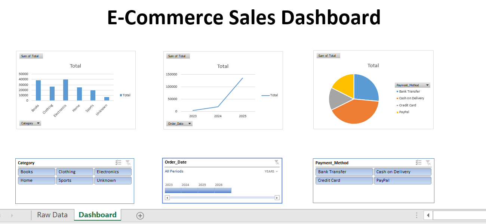

# E-commerce Sales Dashboard (Excel)

An interactive sales dashboard built from a raw, messy e-commerce dataset,
demonstrating data cleaning and dashboard design in Excel.

## Problem
The raw dataset contained duplicate records, inconsistent date and category
formatting, missing values, and data entry errors — including negative
quantities and prices, and mismatched category spellings.

## Process
- Audited the raw dataset and identified every data quality issue before
  making changes
- Cleaned the data using Power Query: removed duplicates, corrected data
  types, standardized inconsistent categories, and resolved invalid or
  missing values
- Built Pivot Tables and Pivot Charts to analyze sales by category, year,
  and payment method
- Added Slicers and a Timeline to make the dashboard interactive and
  filterable

## Dashboard Preview

## Tools Used
Microsoft Excel, Power Query, Pivot Tables, Pivot Charts, Slicers, Timeline
